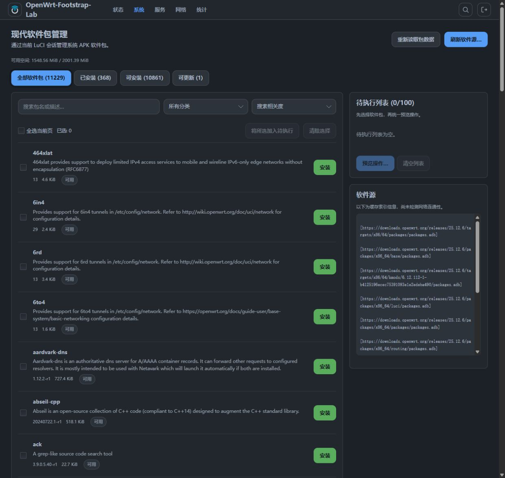
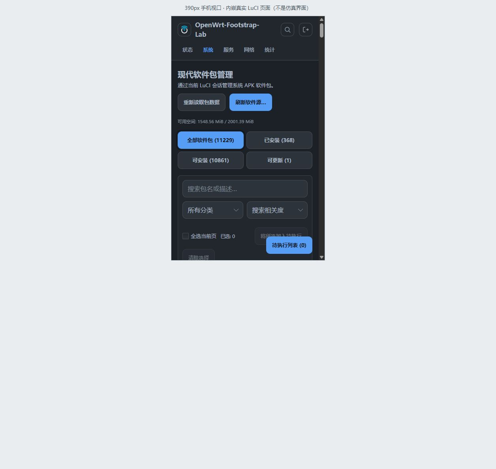
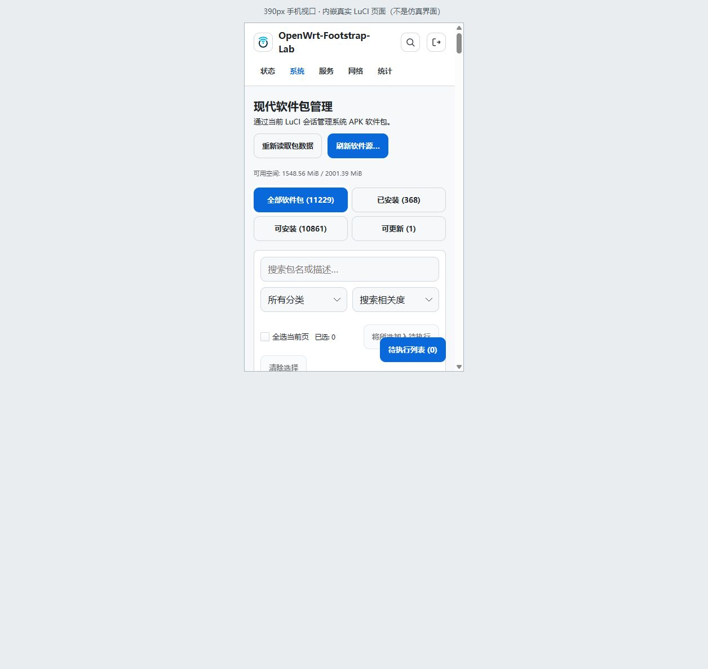

# Modern Package Manager for LuCI

**在 LuCI 中查找软件包、整理操作队列，批量安装、更新与卸载。**

简体中文 · [English](README.en.md)

[下载 v0.2.0-r3](https://github.com/zhongbai2333/luci-app-package-manager-modern/releases/tag/v0.2.0-r3) · [安装](#安装) · [使用](#使用) · [构建](#构建与开发) · [验证记录](docs/verification.md)

`luci-app-package-manager-modern` 是面向 **OpenWrt 25.12 / APK** 的原生 LuCI 插件，与官方“软件包”页面并存。安装后从 **系统 → 现代软件包管理** 打开。

插件沿用 LuCI 的登录、会话、权限和主题，包操作由系统 APK 执行。路由器端无需 Node.js、Python、额外 Web 服务或插件专属的常驻后台。

## 界面预览



<p>
  
  
</p>

截图来自隔离测试环境；手机布局使用浏览器 390px 视口检查。更多主题截图与测试范围见[验证记录](docs/verification.md)。

## 功能

| 任务 | 当前能力 |
| --- | --- |
| 查找软件包 | 全部、已安装、可安装、可更新四种视图；按包名与描述搜索，完整包名和前缀匹配优先 |
| 缩小范围 | LuCI、内核模块、其他包分类；按相关度、名称或包文件体积排序；每页 50 项 |
| 整理操作 | 跨页多选，最多 100 个包的队列；逐项移除或清空，执行前重新读取并校验包状态 |
| 批量执行 | 按安装 → 更新 → 卸载分组执行；显示等待状态、最终日志和 APK 返回码 |
| 查看详情 | 已安装与软件源版本、包文件体积、安装占用、架构、许可证、直接依赖及已安装包的直接反向依赖提示 |
| 查看软件源与存储 | 展示缓存索引信息，可手动刷新软件源索引；读取设备存储的可用空间 |
| 使用现有 LuCI 环境 | 支持只读会话；局部样式继承主题；提供简体中文翻译包 |

## 适用环境

- **系统：** 使用 APK 的 OpenWrt 25.12。opkg 固件不适用。
- **运行依赖：** `luci-base`、`luci-app-package-manager`、`apk`，由设备配置的可信软件源提供。插件需要系统的 `/usr/libexec/package-manager-call`。
- **权限：** 查看页面需要 LuCI 基础读取权限与插件读取权限；在此基础上，安装、更新、卸载和刷新索引还需要插件写入权限。
- **语言：** 界面语言跟随 LuCI 的语言设置；简体中文包提供中文翻译。

发布 APK 的架构标记为 `noarch`。这不代表已在所有处理器架构上验证：现有运行记录覆盖 x86/64 的 25.12.0 用户态环境和 25.12.6 虚拟机，尚未在 ARM/MIPS 设备或真实硬件路由器部署。

## 安装

### 1. 下载与校验

从 [v0.2.0-r3 发布页](https://github.com/zhongbai2333/luci-app-package-manager-modern/releases/tag/v0.2.0-r3) 下载：

| 文件 | 用途 |
| --- | --- |
| `luci-app-package-manager-modern-0.2.0-r3.apk` | 主插件，必需 |
| `luci-i18n-package-manager-modern-zh-cn-0.2.0-r3.apk` | 简体中文翻译，可选 |
| `SHA256SUMS` | 上述两个 APK 的 SHA-256 校验和 |

在下载文件的电脑上，将三个文件放在同一目录，核对下载文件是否与发布记录一致：

```sh
tr -d '\r' < SHA256SUMS | sha256sum -c -
# macOS 可用：tr -d '\r' < SHA256SUMS | shasum -a 256 -c -
```

源码仓库的 [packages/SHA256SUMS](packages/SHA256SUMS) 保留同一份校验记录，APK 单独通过 Releases 发布。

### 2. 安装到测试设备

当前发布附件是未使用生产固件发布密钥签名的开发构建。以下命令中的 `--allow-untrusted` 仅用于在选定的测试设备上安装已核对的本地 APK。正式固件或软件源应由自己的构建系统签名。

先通过 SCP 等方式将 APK 上传到路由器的 `/tmp/`，再在**路由器终端**执行：

```sh
apk add --allow-untrusted /tmp/luci-app-package-manager-modern-0.2.0-r3.apk

# 需要中文时再安装翻译包
apk add --allow-untrusted /tmp/luci-i18n-package-manager-modern-zh-cn-0.2.0-r3.apk

/etc/init.d/rpcd reload
```

依赖应来自可信软件源；若报告依赖缺失，先检查固件版本及软件源配置。不要通过强制忽略依赖来完成安装。

### 3. 打开页面

重新登录 LuCI，打开 **系统 → 现代软件包管理**。如果菜单尚未出现，重新加载浏览器页面。简体中文包不会主动修改 LuCI 的全局语言。

## 使用

1. 选择软件包视图，搜索包名或描述；需要时用分类和排序缩小范围。
2. 点击包名查看详情。列表中的安装、更新或卸载按钮会将操作加入队列；也可以跨页勾选后批量加入。
3. 检查队列中的每个包及其动作，再打开“预览操作…”。插件会重新读取设备状态，检查选择是否仍然有效。
4. 确认执行后等待 APK 返回结果，查看日志与返回码，再核对刷新后的包状态。

在“已安装”视图中，列表按钮默认将包加入**卸载**队列。更新已安装包时，可使用“可更新”视图，或在包详情中选择更新。

两个刷新操作用途不同：**重新读取包数据**读取当前设备状态和缓存索引；**刷新软件源**下载已配置软件源的索引，不会升级已安装包。软件源区域展示缓存信息，不表示所有源当前可达。

### 执行失败与操作限制

- **批量操作不提供事务回滚。** 成功组从队列移除；某组失败或传输异常后，插件停止后续组并尝试重新读取包状态，保留失败组与尚未执行组。失败组内部可能已有部分变更，重试前须核对包状态。
- **连接中断不等于失败回滚或取消。** 插件不会自动重试；关闭页面后服务端操作可能继续。重新进入后，应先读取设备状态再决定下一步。
- **队列和日志只保存在当前页面内存中。** 离页或刷新浏览器后不会恢复；需要留存的日志请在离页前复制。
- **体积与依赖提示只供参考。** 队列统计的包文件体积不包含新增依赖，也不保证剩余磁盘足够。反向依赖提示只覆盖已安装包的直接关系，最终依赖求解由 APK 完成。
- **没有实时百分比。** 系统 helper 返回最终输出，页面显示等待状态与结果。插件不提供上传包、手工 URL 安装、强制覆盖、强制移除或全系统升级入口。

## 常见问题

| 现象 | 检查方向 |
| --- | --- |
| 安装后没有菜单 | 确认主包已安装，重载 rpcd 并重新登录 LuCI；检查插件 ACL 权限 |
| 页面无法加载软件包 | 确认系统使用 APK、运行依赖完整、插件 helper 可执行且会话具有读取权限 |
| 安装或刷新按钮不可用 | 检查是否为只读会话、是否有操作正在执行；包状态重新读取失败时，需要先成功读取才能继续写入 |
| 软件源刷新或包操作报错 | 查看最终日志及 APK 返回码，检查设备网络与软件源配置；核对当前包状态后再选择操作 |
| 安装中文包后仍为英文 | 检查 LuCI 的语言设置，并重新登录或加载页面 |

报告问题时，请附上固件版本、APK 版本、主题、复现步骤与相关日志，并移除软件源凭据等敏感信息。可在 [Issues](https://github.com/zhongbai2333/luci-app-package-manager-modern/issues) 提交。

## 验证范围

以下为仓库[验证记录](docs/verification.md)中对 **0.2.0-r3** 的记录，不代表所有设备与主题均已覆盖。

| 环境或检查 | 已记录结果 |
| --- | --- |
| OpenWrt 25.12.0 x86/64 用户态，APK 3.0.2 | 真实包安装/卸载、测试包批量安装/更新/卸载、只读及未登录权限检查；PRoot 环境含硬件信息替身，不是完整系统启动 |
| OpenWrt 25.12.6 Hyper-V VM，APK 3.0.5 | 插件安装/升级、官方源 `tree` 与 `less` 批量安装/卸载、软件源刷新、失败后队列保留 |
| 主题与布局 | Bootstrap、Footstrap 的桌面和 390px 深浅模式；Argon 3.1.0 桌面深浅模式 |
| 开发机检查 | 21 项自动测试；JS、JSON、中文翻译覆盖、读写 ACL 分离及 helper 语法检查 |

尚未覆盖真实硬件、ARM/MIPS、硬件断电、极低内存、磁盘耗尽及完整固件依赖链构建；手机实机与 Argon 窄视口也没有完整回归。详细条件、截图和权限结果见[验证记录](docs/verification.md)与 [ACL 测试结果](docs/acl-results.json)。

## 构建与开发

### 在 OpenWrt SDK 或固件源码中构建

在匹配的 OpenWrt SDK 或固件源码根目录中准备 LuCI 与 base feeds，并加入本项目：

```sh
git clone https://github.com/zhongbai2333/luci-app-package-manager-modern.git \
  package/luci-app-package-manager-modern
./scripts/feeds update -a
./scripts/feeds install -a
make menuconfig
# LuCI → Applications → luci-app-package-manager-modern
# LuCI → Translations → Chinese Simplified（可选）
make package/luci-app-package-manager-modern/compile V=s
```

构建固件时，对应配置为：

```text
CONFIG_PACKAGE_luci-app-package-manager-modern=y
CONFIG_PACKAGE_luci-i18n-package-manager-modern-zh-cn=y
```

产物通常位于 `bin/packages/<架构>/base/`。Makefile 使用标准 `luci.mk`，并在准备阶段设置 helper 的可执行权限。

已有构建记录使用官方 25.12.0 SDK。由于独立 SDK 缺少完整 base feed，常规依赖构建在 `lucihttp` 缺少 `lua.h` 时停止，随后使用 `NO_DEPS=1` 完成插件打包并在上述环境验证。此记录不等于完整依赖链或固件构建通过；正式集成应使用完整匹配的 feeds。

### 开发机检查

在本仓库根目录执行，与现有 CI 一致使用 Node.js 22；无需安装 npm 依赖：

```sh
npm test
npm run check
sh -n root/usr/libexec/package-manager-modern
```

Node.js 仅用于开发机检查。涉及包操作、权限或主题适配的改动，还应在隔离 OpenWrt 环境验证。

### 源码结构与职责

| 路径 | 职责 |
| --- | --- |
| [Makefile](Makefile) | LuCI 包定义与依赖 |
| [view/system/package-manager-modern.js](htdocs/luci-static/resources/view/system/package-manager-modern.js) | 页面、队列预览与执行流程 |
| [backend.js](htdocs/luci-static/resources/package-manager-modern/backend.js) | LuCI fs/rpc 调用与返回码处理 |
| [model.js](htdocs/luci-static/resources/package-manager-modern/model.js) | 数据解析、搜索排序、队列校验与依赖提示 |
| [style.css](htdocs/luci-static/resources/package-manager-modern/style.css) | 限定在插件范围内的布局样式 |
| [package-manager-modern](root/usr/libexec/package-manager-modern) | 受控参数入口；读取 APK，写入委托系统 helper |
| [menu.d](root/usr/share/luci/menu.d/) / [acl.d](root/usr/share/rpcd/acl.d/) | 原生菜单与分离的读写权限 |
| [po/zh_Hans](po/zh_Hans/) / [tests](tests/) | 简体中文翻译与自动检查 |

接口、参数限制、权限和故障处理设计见[接入设计](docs/integration.md)。欢迎通过 Pull Request 改进功能、翻译或测试，并说明改动验证所用的环境。

## 许可证

本项目采用 [Apache License 2.0](LICENSE)。
